<p class="lead">
<strong>Detection Engineering</strong> is the systematic discipline of designing, building, testing, deploying, and continuously tuning mechanisms that identify suspicious or malicious activity across an IT environment. Rather than writing ad-hoc rules around brittle strings, modern detection engineering treats detections as reliable, testable, and maintainable software artifacts grounded in adversary behavior.
</p>

## 1. Overview & Core Design Principles

A strong detection rule is never as simplistic as *"if string X appears, raise an alert."* An effective detection must answer nine foundational operational and engineering questions:

| Dimension | Key Question Answered |
| :--- | :--- |
| **What** | Which specific behavior or attacker action is being detected? |
| **Why** | Why is that behavior suspicious or linked to a realistic threat? |
| **Where** | Which telemetry sources and log fields contain the required evidence? |
| **How** | What detection logic or analytical method implements the check? |
| **Who / What is affected** | Which user, host, process, service account, IP, or resource is involved? |
| **Confidence** | How reliable is this signal, and what false-positive rate is expected? |
| **Response** | Once confirmed, what triage and containment steps should an analyst take? |
| **Validation** | How is the detection proven to trigger on malicious cases and stay silent on benign ones? |
| **Maintenance** | How will the rule be reviewed, tuned, versioned, and eventually retired? |

Industry models frame detection engineering around continuous feedback and behavior mapping:

* **Continuous Feedback Loop (Splunk Model)**: Detection engineering operates as an ongoing cycle connecting **Visibility**, **Threat Modeling**, **Detection-as-Code (DaC)**, and **Continuous Validation / Threat Hunting** [[1]](#references).
* **Behavior-to-Telemetry Mapping (MITRE ATT&CK)**: MITRE ATT&CK connects adversary techniques to defensive logic through **Detection Strategies** (high-level detection approaches), **Analytics** (platform-specific detection logic), and **Data Components** (specific telemetry properties needed to observe a technique) [[2]](#references) [[3]](#references) [[4]](#references).

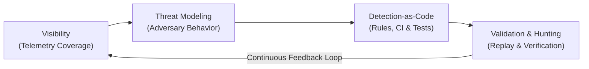

---

## 2. Detection Architecture & Pipeline

Detection architecture defines how raw telemetry is collected, normalized, analyzed, enriched with context, and promoted into findings, alerts, or incidents for investigation and response.

### 2.1 End-to-End Detection Pipeline

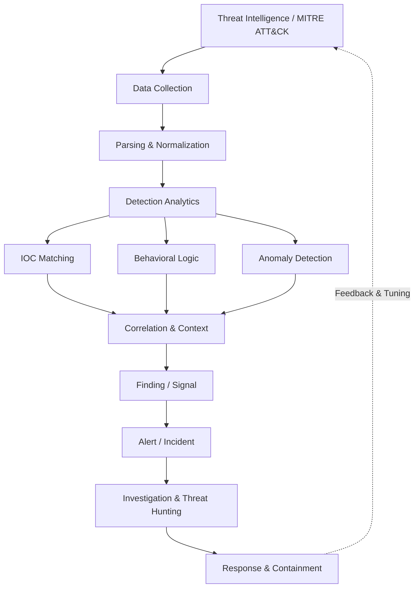

### 2.2 Architecture Layers & Normalization

Organizing the stack into explicit architectural layers prevents tight coupling between log formats and analytical rules:

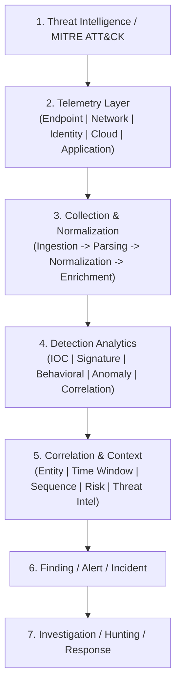

**Normalization** is especially critical in heterogeneous environments with multiple telemetry vendors. Microsoft Sentinel's **Advanced Security Information Model (ASIM)** illustrates this pattern by placing a unified normalization layer between diverse raw event sources and detection analytics, enabling source-agnostic queries and detections [[5]](#references).

### 2.3 Control Plane vs. Data Plane

In modern security architectures, it is helpful to separate the **Engineering / Control Plane** (where rules are designed, tested, and governed) from the **Runtime / Data Plane** (where telemetry streams are evaluated in real time):

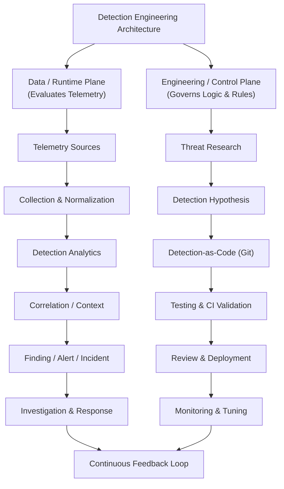

* **Control Plane**: Defines, versions, tests, and manages detection logic using Detection-as-Code workflows (Git repositories, CI/CD validation, threat research).
* **Data Plane**: Ingests and normalizes high-volume telemetry across data lakes, SIEM engines, EDR/XDR agents, or stream processors (such as Kafka/Flink) and executes logic from the Control Plane to emit signals and alerts.

### 2.4 Detection Is Not Alerting

> **CORE DESIGN PRINCIPLE:**
> **Detection ≠ Alert.** Not every anomaly or rule match should immediately page a SOC analyst. Treating every weak indicator as an analyst-facing alert leads directly to alert fatigue.

A detection engine can emit intermediate outputs instead of an immediate page:
* **Signal / Finding**: Low-to-medium confidence anomaly recorded for context.
* **Risk Score**: Incremental risk points attached to a host or user entity.
* **Telemetry Annotation / Enrichment**: Metadata tagging for downstream queries.
* **Correlation Input**: Building block combined with orthogonal evidence over time.

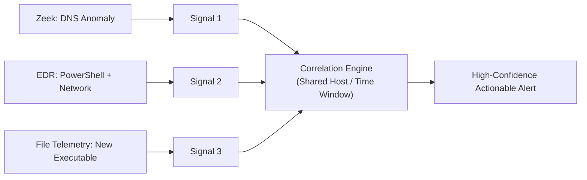

---

## 3. Telemetry Sources: Endpoint, Network & SIEM

Detection quality is bounded by telemetry quality. Without stable, properly scoped visibility into endpoints and network links, even the most sophisticated analytics fail.

### 3.1 Endpoint Telemetry (Windows & Linux)

Endpoint telemetry provides direct visibility into **hosts, processes, parent-child relationships, command lines, file modifications, and local network sockets**.

#### Windows Telemetry
Windows offers rich native and extended event logging:
* **Windows Native Security & System Events**:
  * **Authentication**: `4624` (Successful Logon), `4625` (Failed Logon).
  * **Process & Service Creation**: `4688` (Process Creation), `7045` (New Service Installed).
  * **Privilege & Group Changes**: `4672` (Special Privileges Assigned), `4728` / `4732` (Group Membership Additions).
* **Sysmon (System Monitor)**: Provides granular behavioral building blocks including Process Creation (`Event ID 1`), Network Connection (`Event ID 3`), File Create (`Event ID 11`), Registry Modifications (`Event ID 13`), and DNS Queries (`Event ID 22`) [[6]](#references).
  * *Operational requirement*: Sysmon requires strict configuration filtering and tuning to avoid overwhelming log pipelines with benign OS noise, and Microsoft explicitly notes that Sysmon only records events—analytics and alerting must be executed downstream [[7]](#references).

#### Linux Telemetry
Unlike Windows' centralized Event Log model, Linux telemetry is distributed across specialized layers:
* **Authentication & Access (`/var/log/`)**: `auth.log` or `secure` tracks SSH sessions, PAM authentication, and `sudo` privilege invocations.
* **System & Kernel Auditing**: `auditd` captures granular syscall-level activity (powerful for forensics, though noisy without careful rules), while `journald` aggregates structured systemd service logs.
* **Modern eBPF Telemetry**: Tools such as **Cilium Tetragon** and **Falco** leverage eBPF for low-overhead, kernel-safe instrumentation across Linux hosts and containerized workloads.

On Linux, a single failed SSH attempt is routine internet background noise. Detection value comes from chaining behaviors along the same host or session:

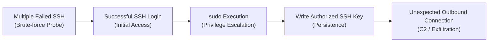

### 3.2 Network Telemetry (PCAP, Suricata, Zeek)

Network detection captures immutable wire evidence across multiple abstraction layers:

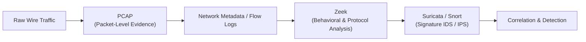

* **PCAP (Packet Capture)**:
  * *Strengths*: Retains full packet-level evidence, supports offline replay for rule validation and regression testing, and remains independent of any single vendor engine.
  * *Trade-offs*: High storage footprint, difficult to query directly at scale, and payload visibility is reduced by modern HTTPS/TLS encryption.
* **Suricata / Snort (Signature IDS/IPS)**: Evaluates live traffic or PCAPs against rule sets defined by an action, protocol header, and matching options [[8]](#references). To suppress noise, Suricata provides stateful tracking and rate-control primitives including `flowbits`, `flowint`, `threshold`, and `detection_filter` [[9]](#references):

```text
alert http $HOME_NET any -> $EXTERNAL_NET any (
    msg:"Suspicious HTTP request";
    flow:established,to_server;
    http.method; content:"POST";
    http.uri; content:"/upload";
    sid:1000001;
    rev:1;
)
```

* **Zeek (Network Behavioral Framework)**: Zeek should be understood as a **network visibility and behavioral scripting framework** rather than a pure signature IDS. Alongside its Signature Framework [[10]](#references), Zeek provides Logging, Notice, Intelligence, File Analysis, and Packet Analysis frameworks. Crucially, its **Notice Framework** enforces `Detection ≠ Action`, separating the observation of anomalous network behavior from the policy decision to raise an alert [[11]](#references):

```text
event dns_request(c: connection, query: string) {
    if ( query_count[c$id$orig_h] > 500 ) {
        NOTICE([$note=Suspicious_DNS,
                $msg="High DNS query volume from host"]);
    }
}
```

### 3.3 SIEM Architecture Overview

A **SIEM (Security Information and Event Management)** system centralizes, normalizes, and correlates telemetry across network, endpoint, identity, and cloud layers:

* **Rule-Based Correlation**: Evaluates fixed thresholds and sequences across normalized events (e.g., failed logins followed by success and privileged execution).
* **UEBA & Behavioral Baselines**: Identifies statistical deviations from established host or user baselines (such as anomalous off-hours data access).
* **Threat Intelligence Matching**: Cross-references incoming IPs, domains, and file hashes in real time against curated IoC feeds.
* **Operational Role**: Eliminates telemetry silos ("single pane of glass"), correlates multi-stage lateral movement to shorten dwell time, and preserves auditable logs for forensic investigations and compliance.

---

## 4. Detection Types, Tooling & Layered Logic

No single detection paradigm covers every threat vector. Robust security programs combine five complementary detection categories:

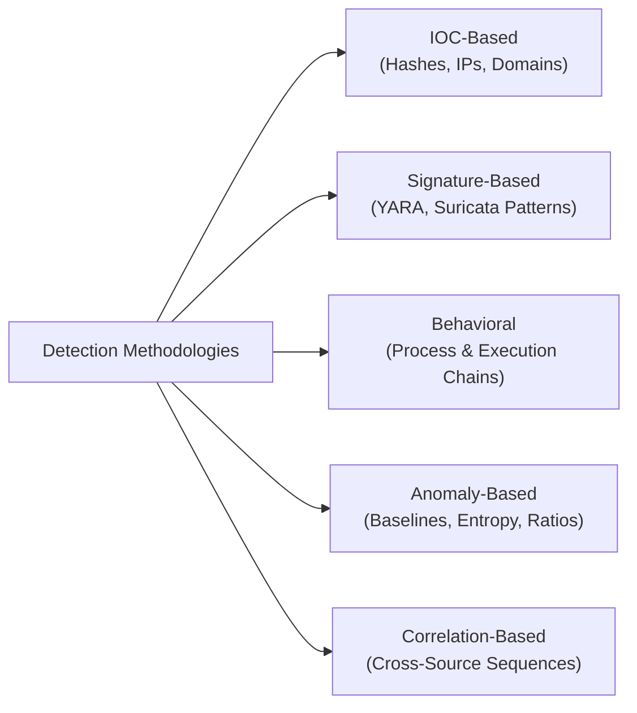

### 4.1 Signature-Based Detection & Hands-On YARA

Signature detection excels at identifying known malware artifacts, exploit payloads, and protocol patterns with high precision and low operational latency—though it remains vulnerable to minor artifact mutations or packing.

**YARA** describes binary or memory patterns using three structural sections: `meta`, `strings`, and `condition` [[12]](#references). Relying on a single filename, hash, or solitary string produces fragile rules. Robust YARA rules combine **file format headers, multiple string indicators, PE/ELF characteristics, and behavioral API/syscall evidence**.

#### Practical YARA Demonstration: Execution vs. Harmless String Reference

To illustrate why multi-condition YARA rules outperform naive string matching, consider two compiled Linux ELF binaries:

1. **`sample.c`** — Invokes `execve` to spawn `/bin/sh`:

```c
// sample.c
#include <unistd.h>

int main(void) {
  char *args[] = {"/bin/sh", NULL};
  execve("/bin/sh", args, NULL);

  return 0;
}
```

2. **`nothing.c`** — Merely contains the literal string `"/bin/sh"` inside a `printf` call without spawning a shell:

```c
// nothing.c
#include <stdio.h>

int main(void) {
  char *s = "/bin/sh";

  printf("benign string output: %s \n", s);

  return 0;
}
```

3. **`test.yar`** — Combines ELF magic bytes (`7F 45 4C 46` at offset `0`), the target path string, and the `execve` symbol/string:

```text
rule Linux_Shell_Execution
{
    meta:
        description = "Detect ELF binary invoking execve with /bin/sh"

    strings:
        $elf = { 7F 45 4C 46 }
        $shell = "/bin/sh" ascii
        $execve = "execve" ascii

    condition:
        $elf at 0 and $shell and $execve
}
```

When compiled and scanned, a naive rule matching only `"/bin/sh"` triggers a false positive on `nothing`. Requiring `$elf at 0 and $shell and $execve` restricts matches to actual ELF binaries referencing both the shell path and execution primitive.

### 4.2 Portable Log Detection with Sigma

**Sigma** is an open YAML-based rule format for describing log detections independently of the underlying SIEM or EDR query language [[13]](#references). Sigma rules follow a standardized pipeline—`Metadata -> Logsource -> Detection -> Condition -> False Positives -> Severity -> ATT&CK Tags` [[14]](#references)—and support reusable **filters** to express environment-specific exclusions in Detection-as-Code repositories [[15]](#references):

```yaml
title: Suspicious PowerShell Encoded Command Execution
id: example-sigma-powershell-enc
status: test

logsource:
    category: process_creation
    product: windows

detection:
    selection:
        Image|endswith:
            - '\powershell.exe'
            - '\pwsh.exe'
        CommandLine|contains:
            - '-enc'
            - '-encodedcommand'
    condition: selection

falsepositives:
    - Legitimate administrative deployment scripts

level: high

tags:
    - attack.execution
    - attack.t1059.001
```

### 4.3 Behavioral & Correlation Detection

Behavioral detection models **execution chains** rather than static strings. While a single `powershell.exe` launch may be benign administrative activity, a chained sequence produces a high-confidence signal:

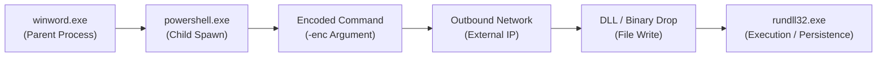

**Correlation detection** extends behavioral logic across multiple entities, event sources, and time windows:

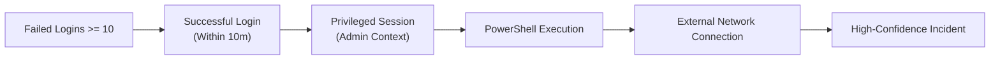

```text
IF
    failed_login >= 10
AND
    successful_login occurs within 10 minutes
AND
    privileged_process_created
AND
    destination_ip is external
THEN
    raise high-confidence alert
```

### 4.4 Layered Detection Logic & Technology Matrix

| Layer | Analytical Mechanism | Representative Example |
| :--- | :--- | :--- |
| **Layer 1 — IOC** | Exact indicator match | `dst_ip == known_c2_ip` |
| **Layer 2 — Signature** | Structural payload/file pattern | Suricata URI match or YARA rule |
| **Layer 3 — Behavior** | Process & network sequence | `PowerShell -> Outbound HTTP -> Binary Write` |
| **Layer 4 — Correlation** | Multi-stage / cross-source chaining | `Credential Access -> PrivEsc -> Persistence` |
| **Layer 5 — Context / Risk** | Asset & identity criticality weighting | `+ Privileged Account + Crown-Jewel Server` |

Choosing the right format depends directly on telemetry and adversary behavior—never force every detection into a single language:

| Requirement | Recommended Technology / Format |
| :--- | :--- |
| Windows log detection | Sigma / SIEM / EDR |
| Malware & binary file detection | YARA |
| Network exploit / payload signatures | Suricata |
| Network protocol behavioral analysis | Zeek |
| Raw packet-level evidence & replay | PCAP |
| Multi-event cross-source correlation | SIEM / Detection Engine |

---

## 5. MITRE ATT&CK Mapping & Detection Coverage

Rather than treating MITRE ATT&CK as a binary coverage checklist (`T1059.001 = YES`), modern detection engineering models coverage through structured dependencies [[2]](#references) [[3]](#references) [[4]](#references) [[16]](#references):

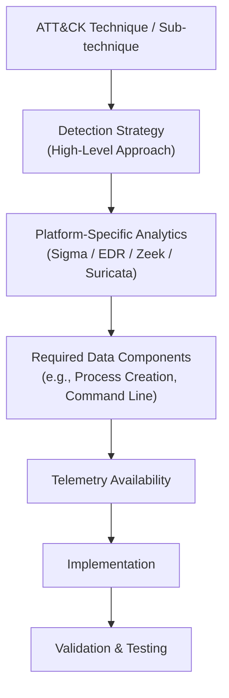

For **T1059.001 (PowerShell Execution)**, a single technique branches across multiple platform analytics and required telemetry components:

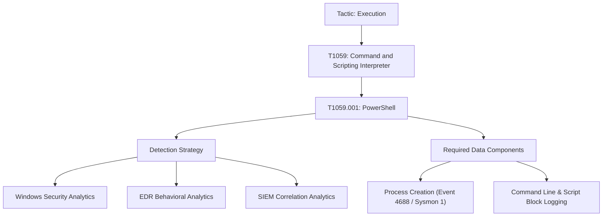

> **ATT&CK v18 Structural Note:** Starting with ATT&CK v18 (October 28, 2025), defensive content was reorganized so technique-level detections are represented via **Detection Strategies** and **Analytics**, **Data Components** were updated, and legacy **Data Sources** were deprecated (retained only for reference) [[18]](#references).

---

## 6. Detection Lifecycle, Testing & Quality Engineering

### 6.1 End-to-End Detection Lifecycle

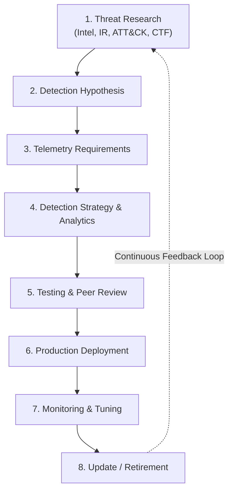

1. **Threat Research & Hypothesis**: Begin from attacker behavior—not rule syntax. Formulate a testable hypothesis before writing a query:
   > *"An adversary abusing PowerShell for execution is likely to supply obfuscated or encoded command-line arguments and subsequently establish an external network connection."*
2. **Telemetry Engineering**: Confirm that required fields (e.g., Process Creation, Command Line, Parent Process, DNS, Network Connection) actually exist in normalized form before promising coverage.

### 6.2 Structured Validation & PCAP Replay Testing

Every rule in a Detection-as-Code pipeline should ship with explicit test metadata covering four validation tiers:

* **Positive Test**: Simulated or replayed malicious behavior **must** trigger the detection.
* **Negative Test**: Similar benign administrative activity **must not** trigger the detection.
* **Edge Case Test**: Documented behavior on obfuscation variants or incomplete logs.
* **Regression Test**: Comparing `Rule v1` vs. `Rule v2` outputs against a fixed dataset or PCAP archive before promotion [[1]](#references) [[17]](#references).

```yaml
name: powershell_encoded_download_test
description: Validate detection of obfuscated PowerShell followed by network activity
attack:
    technique: T1059
    subtechnique: T1059.001
precondition: Sysmon Event ID 1 and Event ID 3 enabled
input: replay_powershell_enc_beacon.json
expected:
    match: true
    severity: high
false_positive_tests:
    - benign_sccm_deployment_script.json
cleanup: clear test session artifacts
```

For network detections, offline **PCAP replay** makes regression testing deterministic (`suricata -r malicious.pcap`):

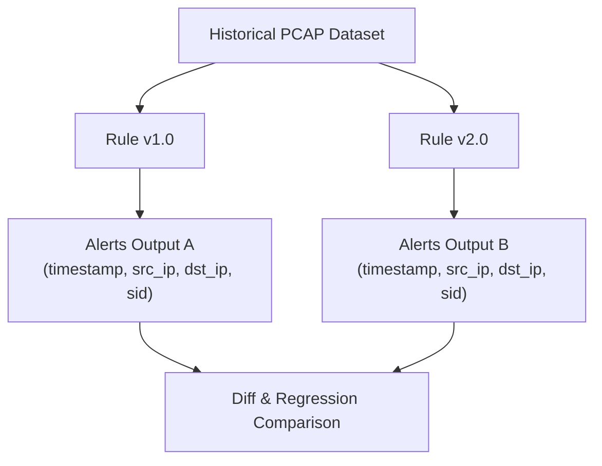

### 6.3 Detection Quality Metrics

Evaluating detections purely on *"Did the rule fire?"* hides operational failure modes. Track these metrics together:

* **Precision**: `TP / (TP + FP)` (signal-to-noise ratio).
* **Recall**: `TP / (TP + FN)` (ability to catch true threats).
* **Alert Volume**: Total alerts emitted per day.
* **Analyst Load**: Average investigation time required per alert.
* **Detection Latency**: Elapsed time between raw event occurrence and alert emission.
* **Coverage & Stability**: Depth of ATT&CK analytics backed by evidence and resilience to normal environment drift.

### 6.4 False Positive Management & Tuning

False positives are a normal engineering reality. **Never fix a noisy rule by blindly deleting or disabling it without root-cause analysis.**

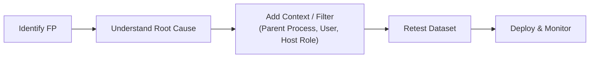

For example, `PowerShell -EncodedCommand` legitimately appears in software deployment tools, IT automation, and endpoint monitoring agents. Combining `ParentProcess`, `User`, `HostRole`, `Destination`, and `Frequency` turns a noisy rule into a high-precision analytic [[15]](#references).

### 6.5 Severity vs. Confidence Matrix

Operational triage separates **Severity** (potential business impact if true) from **Confidence** (certainty that the match represents malicious intent):

| Severity \ Confidence | Low | Medium | High |
| :--- | :--- | :--- | :--- |
| **Low** | Informational | Low | Low |
| **Medium** | Low | Medium | High |
| **High** | Medium | High | **Critical** |
| **Critical** | High | **Critical** | **Critical** |

* *Example 1*: Known malware hash match -> **Severity: Medium**, **Confidence: 0.99** (high certainty).
* *Example 2*: Suspicious PowerShell flag without network/child telemetry -> **Severity: High**, **Confidence: 0.50–0.60** (emit as a Signal for correlation rather than paging immediately).

> *Note: This matrix is an operational design pattern synthesized for triage workflows, not a mandatory standard imposed by MITRE, Sigma, or any specific vendor.*

### 6.6 Signal -> Finding -> Alert -> Incident & Chaining

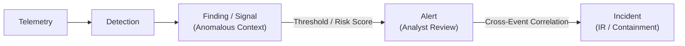

Individual rules can also be chained into multi-stage **Detection Chains**—for example: `(A) Credential Access -> (B) New Privileged Session -> (C) Lateral Movement -> (D) Suspicious Outbound Connection -> Incident` [[2]](#references).

### 6.7 Detection-as-Code, Documentation & Maturity Model

Managing detections in Git brings software engineering rigor to SOC operations [[13]](#references):

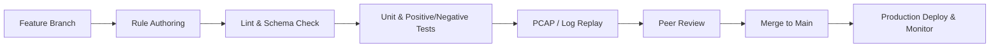

Example **Detection-as-Code Repository Layout**:

```text
detections/
├── endpoint/
│   ├── windows/
│   │   ├── sigma/
│   │   └── yara/
│   └── linux/
├── network/
│   ├── suricata/
│   └── zeek/
├── correlation/
├── tests/
├── datasets/
└── documentation/
```

Every rule should pass a **5-pillar review** (**Logic**, **Telemetry**, **Performance**, **False Positives**, **Response**) and ship with standardized metadata and an analyst runbook:

```yaml
id: det-win-ps-download-001
name: Suspicious PowerShell Download
status: production
severity: high
confidence: medium
platform: windows
data_sources:
    - Windows Security 4688
    - Sysmon Event ID 1
    - Sysmon Event ID 3
attack:
    tactic: command-and-control
    technique: T1105
false_positives:
    - Software deployment automation
owner: detection-engineering
response:
    investigation:
        - Inspect parent process and full decoded command line
        - Check outbound destination IP/domain reputation
        - Retrieve downloaded payload and scan with YARA
    containment:
        - Isolate host if unauthorized C2 activity is confirmed
```

#### Operational Detection Maturity Model

1. **Level 1 — IOC**: Static matching on hashes, IPs, domains, and URLs.
2. **Level 2 — Signature**: Known exploit, malware, and protocol signatures (YARA, Suricata).
3. **Level 3 — Behavioral**: Process trees, network anomalies, and authentication patterns.
4. **Level 4 — Correlation**: Cross-source event chaining over sliding time windows.
5. **Level 5 — Adaptive / Contextual**: Baselines, entity risk scoring, threat-intel enrichment, and continuous validation.

---

## 7. Recommended Stack, Checklist & Core Principles

### 7.1 Integrated Reference Detection Stack

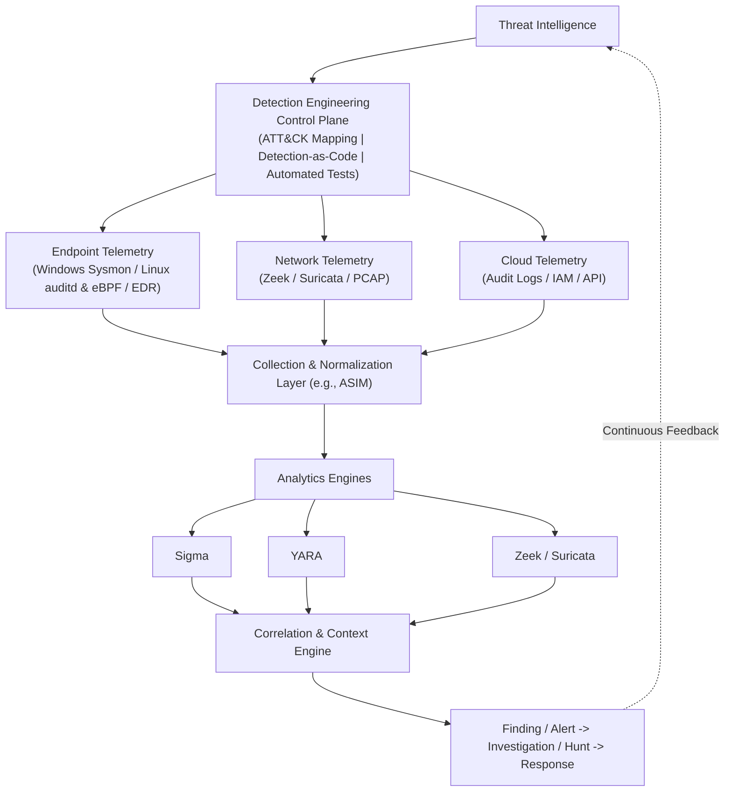

### 7.2 Operational DOs & DON'Ts

* **DO**:
  * Design detections from attacker behavior and test both positive and negative cases.
  * Define telemetry requirements before writing rules; normalize fields where cross-source correlation is needed.
  * Reuse PCAP and log datasets for automated regression testing.
  * Separate detection signals from alerting thresholds; version-control all rules with clear owners and review dates.
* **DON'T**:
  * Page an analyst on every anomalous event or treat ATT&CK coverage as a binary checkbox.
  * Copy public rules blindly into production without validation or performance profiling.
  * Disable noisy rules without investigating false-positive causes, or rely solely on static hashes/IPs.

### 7.3 Detection Engineering Readiness Checklist

* **Data**: Required telemetry identified and actually collected; required fields verified; timestamps accurate; host/user/network identifiers normalized where needed.
* **Detection**: Hypothesis and ATT&CK Detection Strategy documented; Data Components mapped; severity, confidence, known false positives, and documented exceptions assigned.
* **Testing**: Positive, negative, edge-case, PCAP/log replay, regression, and query-performance tests executed.
* **Production**: Peer-reviewed; alert volume measured; actionable analyst runbook attached; rule owner, review cadence, and tuning feedback loop established.

### 7.4 Fourteen Core Principles

1. Start with adversary behavior, not rule syntax.
2. Detection quality depends directly on telemetry quality.
3. Model a clear detection hypothesis before writing analytics.
4. Use **Detection Strategies** for high-level approaches.
5. Use **Analytics** for platform-specific implementation.
6. Identify the exact **Data Components** required to prove the behavior.
7. A detection does not necessarily need to create an alert.
8. Correlation adds context and raises signal confidence.
9. Every detection needs a repeatable validation strategy.
10. False positives are a normal engineering problem—solve them with context, not deletion.
11. Manage detection rules as version-controlled Detection-as-Code.
12. Evaluate ATT&CK coverage by evidence and analytics depth, never a binary checklist.
13. Prefer layered detection over searching for a single "perfect" rule.
14. Detection Engineering is a continuous lifecycle.

---

## References & Source Notes

<a id="references"></a>

1. **Splunk** — *What Is Detection Engineering? A Complete Guide to Modern Threat Detection* (June 10, 2026). [splunk.com](https://www.splunk.com/en_us/blog/learn/detection-engineering.html)
2. **MITRE ATT&CK** — *Detection Strategies*. [attack.mitre.org/detectionstrategies/](https://attack.mitre.org/detectionstrategies/)
3. **MITRE ATT&CK** — *Analytics*. [attack.mitre.org/analytics/](https://attack.mitre.org/analytics/)
4. **MITRE ATT&CK** — *Data Components*. [attack.mitre.org/datacomponents/](https://attack.mitre.org/datacomponents/)
5. **Microsoft Learn** — *Normalization and the Advanced Security Information Model (ASIM)* (May 3, 2026). [learn.microsoft.com](https://learn.microsoft.com/en-us/azure/sentinel/normalization)
6. **Microsoft Learn** — *Understanding Sysmon events*. [learn.microsoft.com](https://learn.microsoft.com/en-us/windows/security/operating-system-security/sysmon/sysmon-events)
7. **Microsoft Learn** — *Enable and configure Sysmon in Windows*. [learn.microsoft.com](https://learn.microsoft.com/en-us/windows/security/operating-system-security/sysmon/how-to-enable-sysmon)
8. **OISF / Suricata Documentation** — *Rules*. [docs.suricata.io](https://docs.suricata.io/en/latest/rules/)
9. **OISF / Suricata Documentation** — *Thresholding Keywords*. [docs.suricata.io](https://docs.suricata.io/en/latest/rules/thresholding.html)
10. **Zeek Documentation** — *Signature Framework (v6.2.1)*. [docs.zeek.org](https://docs.zeek.org/en/v6.2.1/frameworks/signatures.html)
11. **Zeek Documentation** — *Notice Framework*. [docs.zeek.org](https://docs.zeek.org/en/current/frameworks/notice.html)
12. **YARA Documentation** — *Writing YARA Rules*. [yara.readthedocs.io](https://yara.readthedocs.io/en/stable/writingrules.html)
13. **Sigma Documentation** — *Getting Started*. [sigmahq.io](https://sigmahq.io/docs/)
14. **Sigma Documentation** — *Rules*. [sigmahq.io](https://sigmahq.io/docs/basics/rules.html)
15. **Sigma Documentation** — *Filters*. [sigmahq.io](https://sigmahq.io/docs/meta/filters.html)
16. **MITRE ATT&CK** — *Detections and Analytics*. [attack.mitre.org](https://attack.mitre.org/resources/get-started/detections-and-analytics/)
17. **Elastic Security** — *Detections and alerts*. [elastic.co](https://www.elastic.co/guide/en/security/current/detection-engine-overview.html)
18. **MITRE ATT&CK** — *October 2025 / ATT&CK v18 Updates*. [attack.mitre.org](https://attack.mitre.org/resources/updates/updates-october-2025/)
19. **HCMUT Forensics Seminar Series** — *Detection Engineering for Digital Forensics* (August 2026), Faculty of Computer Science and Engineering, Ho Chi Minh City University of Technology.

> **Source Notes:** Concepts regarding MITRE Detection Strategies, Analytics, Data Components, Sigma, YARA, Zeek, Suricata, Sysmon/ASIM, and the Splunk/Elastic detection lifecycles are derived from the primary documentation cited above. Operational design patterns—such as the Severity/Confidence matrix, 5-level maturity model, internal detection schema, review checklists, and example repository layout—represent synthesized educational recommendations rather than mandatory standards from a single vendor.
