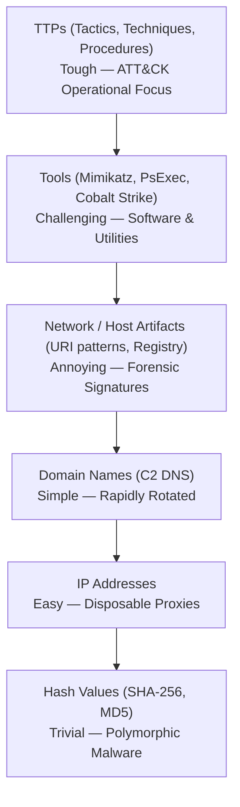
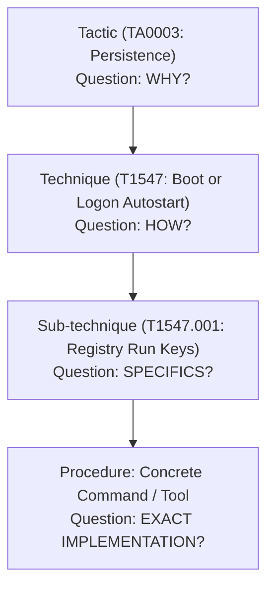
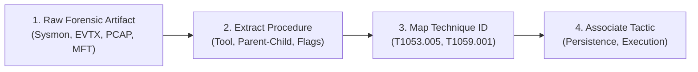
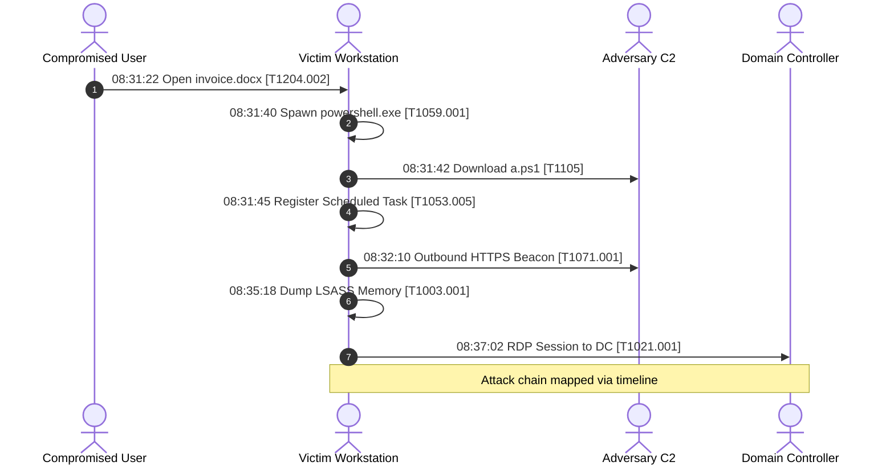

<p class="lead">
Traditional perimeter defenses and IOC-based detection often fail against sophisticated adversaries who continuously rotate IP addresses, domain names, and file hashes. In modern Digital Forensics and Incident Response (DFIR), defensive operations must ground themselves in observable adversary behaviors: the Tactics, Techniques, and Procedures (TTPs) documented within the MITRE ATT&CK framework.
</p>

## 1. Context & Core Philosophy: Threat-Informed Defense

For decades, enterprise security relied predominantly on vulnerability management (cataloging CVEs and tracking CVSS scores) combined with reactive indicator blocking (blacklisting MD5 hashes and malicious IPs). While necessary for baseline hygiene, this model is inherently reactive: adversaries easily bypass indicator-based controls through automated payload re-compilation, polymorphism, and disposable cloud redirectors.

**Threat-Informed Defense** fundamentally shifts the operational focus from *what tools an attacker used* to *how the attacker accomplished their objective*. 



David Bianco's **Pyramid of Pain** illustrates this operational asymmetry:
* **Hash Values & IP Addresses (Trivial / Easy)**: Cost zero operational overhead for an attacker to alter. A single bit change in a binary yields a completely new SHA-256 hash.
* **Domain Names & Network Artifacts (Simple / Annoying)**: Incur minor friction; adversaries register new domains or reconfigure proxy ports.
* **Tools (Challenging)**: Requires the attacker to engineer or source new execution software, altering build scripts and testing pipelines.
* **TTPs (Tough)**: Represents the apex of the pyramid. If a blue team detects and neutralizes the underlying behavior—such as process injection into `lsass.exe` or Kerberos ticket forging—the adversary must rethink and re-engineer their entire operational methodology.

### What is MITRE ATT&CK?

**MITRE ATT&CK** (*Adversary Tactics, Techniques, & Common Knowledge*) is a globally accessible, curated knowledge base of adversary behavior based on real-world observations. Unlike theoretical taxonomies, every technique documented in ATT&CK is derived from confirmed intrusions, threat intelligence reports, and post-incident forensic data.

The framework is organized into three primary operational matrices:
1. **Enterprise Matrix**: Covers Windows, Linux, macOS, Cloud environments (AWS, Azure, GCP, Office 365, Google Workspace), Identity Infrastructure (Active Directory, Entra ID), and Containers (Docker, Kubernetes).
2. **Mobile Matrix**: Details attack tradecraft targeting iOS and Android mobile platforms.
3. **ICS Matrix**: Catalogs adversary behaviors targeting Industrial Control Systems and Operational Technology (OT) networks.

---

## 2. Deconstructing the ATT&CK Taxonomy

One of the most frequent points of confusion in security operations is distinguishing between the hierarchical tiers of the framework: **Tactics**, **Techniques**, **Sub-techniques**, and **Procedures**.



### Hierarchy Breakdown

| Level | Guiding Question | Architectural Role | Concrete Case (e.g. APT29 / Cozy Bear) |
| :--- | :--- | :--- | :--- |
| **Tactic** | **WHY?** | The adversary's technical objective; the underlying motive for executing an action. | `TA0003: Persistence` (Maintain long-term access across reboots). |
| **Technique** | **HOW?** | The non-platform-specific technical method utilized to achieve the tactical goal. | `T1547: Boot or Logon Autostart Execution`. |
| **Sub-technique** | **SPECIFICS?** | The specific mechanism within an OS or service implementing the technique. | `T1547.001: Registry Run Keys / Startup Folder`. |
| **Procedure** | **EXACT CMD / TOOL** | The concrete execution command, API hook, or custom malware script observed in the forensic artifact. | `reg.exe add HKCU\Software\Microsoft\Windows\CurrentVersion\Run /v Update /t REG_SZ /d "C:\Users\Public\payload.exe"` |

> **IMPORTANT PRINCIPLE:**  
> A tool (e.g., *Mimikatz*, *PsExec*, *Chisel*) is **never** a technique. A tool is an implementation mechanism that executes one or more specific *procedures*. For example, *Mimikatz* executes procedures that map to `T1003.001` (LSASS Memory Dumping), `T1558.001` (Golden Ticket), and `T1003.002` (SAM Database Dumping).

---

## 3. The Enterprise Matrix & Core DFIR Tactics

The MITRE ATT&CK Enterprise Matrix spans **14 core tactical stages**, modeling the full progression of an intrusion lifecycle from pre-compromise staging to final objective execution:

| Tactic ID | Enterprise Tactic | Tactic ID | Enterprise Tactic |
| :--- | :--- | :--- | :--- |
| [`TA0043`](https://attack.mitre.org/tactics/TA0043/) | **Reconnaissance** | [`TA0006`](https://attack.mitre.org/tactics/TA0006/) | **Credential Access** |
| [`TA0042`](https://attack.mitre.org/tactics/TA0042/) | **Resource Development** | [`TA0007`](https://attack.mitre.org/tactics/TA0007/) | **Discovery** |
| [`TA0001`](https://attack.mitre.org/tactics/TA0001/) | **Initial Access** | [`TA0008`](https://attack.mitre.org/tactics/TA0008/) | **Lateral Movement** |
| [`TA0002`](https://attack.mitre.org/tactics/TA0002/) | **Execution** | [`TA0009`](https://attack.mitre.org/tactics/TA0009/) | **Collection** |
| [`TA0003`](https://attack.mitre.org/tactics/TA0003/) | **Persistence** | [`TA0011`](https://attack.mitre.org/tactics/TA0011/) | **Command & Control** |
| [`TA0004`](https://attack.mitre.org/tactics/TA0004/) | **Privilege Escalation** | [`TA0010`](https://attack.mitre.org/tactics/TA0010/) | **Exfiltration** |
| [`TA0005`](https://attack.mitre.org/tactics/TA0005/) | **Defense Evasion** | [`TA0040`](https://attack.mitre.org/tactics/TA0040/) | **Impact** |

### Top 6 Core Tactics in Forensic Triage

While an adversary may touch all 14 tactics, incident response investigations routinely center around 6 key operational areas where host and network artifacts leave high-fidelity traces:

1. **Initial Access (`TA0001`)**:
   * *Spearphishing Attachment* ([T1566.001](https://attack.mitre.org/techniques/T1566/001/)): Malicious document attachments (`.docx`, `.xlsm`, `.iso`, `.vhd`). Evidence found in email gateway logs, Mark-of-the-Web (MOTW) NTFS alternate data streams (`Zone.Identifier`), and browser download histories.
   * *Exploit Public-Facing Application* ([T1190](https://attack.mitre.org/techniques/T1190/)): Edge exploitation of web servers, VPN gateways, or firewalls. Evidence found in web server access logs, reverse proxy telemetry, and crash dumps.

2. **Execution (`TA0002`)**:
   * *Command and Scripting Interpreter: PowerShell* ([T1059.001](https://attack.mitre.org/techniques/T1059/001/)): Heavily leveraged for in-memory fileless execution. Evidence found in Windows Event ID 4104 (Script Block Logging), Event ID 4103 (Pipeline Execution), and Sysmon Event ID 1 (Process Creation).
   * *Windows Command Shell* ([T1059.003](https://attack.mitre.org/techniques/T1059/003/)): Batch scripts and interactive cmdline shells spawned by web servers or service executables.

3. **Persistence (`TA0003`)**:
   * *Registry Run Keys / Startup Folder* ([T1547.001](https://attack.mitre.org/techniques/T1547/001/)): Modifying `HKCU\Software\Microsoft\Windows\CurrentVersion\Run` or `HKLM\Software\Microsoft\Windows\CurrentVersion\RunOnce`. Traced via offline registry parsing (`NTUSER.DAT`, `SYSTEM`), Sysmon Event ID 13, and MFT transaction timestamps.
   * *Scheduled Task/Job: Scheduled Task* ([T1053.005](https://attack.mitre.org/techniques/T1053/005/)): Registering tasks via `schtasks.exe` or COM interfaces. Evidence found in `C:\Windows\System32\Tasks`, TaskScheduler Event ID 106 (Task Scheduled) and Event ID 200 (Action Started).

4. **Credential Access (`TA0006`)**:
   * *OS Credential Dumping: LSASS Memory* ([T1003.001](https://attack.mitre.org/techniques/T1003/001/)): Dumping the process memory of `lsass.exe` using MiniDumpWriteDump, ProcDump, or native utilities (comsvcs.dll). Evidence visible via Sysmon Event ID 10 (`ProcessAccess` with `GrantedAccess` requesting `0x1010` or `0x1F0FFF`).
   * *Credentials from Password Stores: Credentials from Web Browsers* ([T1555.003](https://attack.mitre.org/techniques/T1555/003/)): Extracting DPAPI-protected master keys to decrypt browser SQLite credential vaults (`Login Data`).

5. **Lateral Movement (`TA0008`)**:
   * *Remote Services: SMB/Windows Admin Shares* ([T1021.002](https://attack.mitre.org/techniques/T1021/002/)): PsExec-style service creation over default admin shares (`C$`, `ADMIN$`, `IPC$`). Correlated via Windows Security Event ID 4624 (Logon Type 3: Network), Event ID 7045 (New Service Installed), and SMB Named Pipe tree connects.
   * *Remote Services: Remote Desktop Protocol* ([T1021.001](https://attack.mitre.org/techniques/T1021/001/)): Direct interactive remote access. Evidence recorded in `Microsoft-Windows-TerminalServices-LocalSessionManager/Operational` (Event ID 21: Session logon succeeded, Event ID 25: Session reconnection).

6. **Exfiltration (`TA0010`)**:
   * *Exfiltration Over C2 Channel* ([T1041](https://attack.mitre.org/techniques/T1041/)): Packaging stolen data into existing outbound command-and-control beacons.
   * *Exfiltration to Cloud Storage* ([T1567.002](https://attack.mitre.org/techniques/T1567/002/)): Using legitimate cloud services (Mega, OneDrive, Google Drive, AWS S3) via rclone or API tokens to bypass perimeter DLP.

### Visualizing Coverage with ATT&CK Navigator

The **MITRE ATT&CK Navigator** is the industry-standard visualization matrix used by security teams to model threat actor profiles, map detection coverage, and conduct defensive gap analysis:

<figure>
  
  <figcaption>Figure 1: MITRE ATT&CK Navigator enterprise matrix layer illustrating tactic columns, technique categorization, and color-coded detection coverage scoring.</figcaption>
</figure>

In defensive engineering, Navigator layers allow analysts to overlay threat intelligence:
* **Red Layer**: Techniques known to be actively utilized by adversaries targeting the organization's industry sector.
* **Blue Layer**: Techniques currently monitored with validated detection alerts in SIEM/EDR.
* **Intersection / Delta**: Highlights critical detection blind spots (*Gap Analysis*), directing where telemetry collection must be prioritized.

---

## 4. The 4-Step Forensic Evidence Mapping Methodology

Translating raw, unstructured evidence into standardized ATT&CK mappings requires a disciplined, repeatable procedure. Attempting to map evidence directly to a high-level technique without dissecting the concrete procedure produces misleading or incomplete classifications.



### The 4-Step Pipeline:

1. **Raw Log / Artifact Ingestion**: Capture the immutable raw telemetry (Windows Security Event Logs, Sysmon, Zeek transaction logs, packet captures, disk forensic parses).
2. **Extract Procedure & Parameters**: Identify the executing binary, parent-child process relationships, full command-line arguments, environment variables, and target file paths.
3. **Map Technique & Sub-technique IDs**: Cross-reference the identified mechanism against the ATT&CK knowledge base. Single commands frequently trigger multiple techniques.
4. **Associate Tactic Goal**: Determine the attacker's operational motivation at that specific juncture of the intrusion lifecycle.

### Practical Case Walkthrough: Sysmon Process Creation

Consider the following Sysmon Event ID 1 record recovered during host triage:

```json
{
  "EventID": 1,
  "TimeCreated": "2026-07-28T08:31:45.120Z",
  "Image": "C:\\Windows\\System32\\schtasks.exe",
  "CommandLine": "schtasks.exe /create /tn \"OneDrive Update\" /tr \"powershell.exe -nop -w hidden -enc JABzACAAPQAgAE4AZQB3AC0ATwBiAGo...\" /sc onlogon /ru SYSTEM",
  "ParentImage": "C:\\Windows\\System32\\cmd.exe",
  "ParentCommandLine": "cmd.exe /c C:\\Users\\Public\\install.bat",
  "User": "VICTIM-PC\\Administrator"
}
```

#### Step-by-Step Dissection:

* **Step 1 (Raw Artifact)**: Sysmon Event ID 1 recording command execution under an administrative security context.
* **Step 2 (Procedure Extraction)**:
  * The native Windows binary `schtasks.exe` is executed.
  * Arguments specify task name `"OneDrive Update"` masquerading as a legitimate cloud synchronizer.
  * Task action triggers `powershell.exe` with non-interactive flags (`-nop -w hidden`) executing a Base64-encoded string (`-enc ...`).
  * Trigger schedule is configured for `/sc onlogon` running with elevated privileges (`/ru SYSTEM`).
* **Step 3 (Multi-Technique Mapping)**:
  * **[T1053.005](https://attack.mitre.org/techniques/T1053/005/)**: *Scheduled Task/Job: Scheduled Task* (Utilization of `schtasks.exe` to configure a task).
  * **[T1059.001](https://attack.mitre.org/techniques/T1059/001/)**: *Command and Scripting Interpreter: PowerShell* (PowerShell binary invocation to execute instructions).
  * **[T1027](https://attack.mitre.org/techniques/T1027/)**: *Obfuscated/Encoded Files or Information* (Use of Base64 command-line payload encoding).
  * **[T1036.005](https://attack.mitre.org/techniques/T1036/005/)**: *Masquerading: Match Legitimate Name or Location* (Task named `"OneDrive Update"` to evade casual inspection).
* **Step 4 (Tactic Association)**:
  * `TA0003: Persistence`: Primary objective is to survive system reboots by executing every time a user logs on.
  * `TA0002: Execution`: Secondary objective is code execution via the PowerShell engine.
  * `TA0005: Defense Evasion`: Concealing the true payload nature via Base64 obfuscation and deceptive task naming.

---

## 5. Timeline Analysis & Attack Chain Reconstruction

In DFIR, isolated artifact mapping is not enough. Forensic investigators must establish the **temporal relationship** between events to reconstruct the complete intrusion sequence:

* *When did the initial compromise occur (Patient Zero)?*
* *How long was adversary dwell time before persistence was established?*
* *Were credentials harvested before or after lateral movement was initiated?*

Correlating timestamps from disparate forensic sources—EVTX logs, `$MFT` `$STANDARD_INFORMATION` and `$FILE_NAME` attributes, Prefetch execution counters, and network session PCAPs—produces a normalized **Super-Timeline**.



### Comprehensive Incident Timeline Mapping

The following real-world incident timeline illustrates the progressive stages of an enterprise intrusion, mapping observed forensic artifacts directly to ATT&CK tactics and techniques:

| Timestamp (UTC) | Forensic Evidence / Observed Procedure | ATT&CK Tactic | ATT&CK Technique | Primary Evidence Source |
| :--- | :--- | :--- | :--- | :--- |
| `08:31:22` | User executes weaponized email attachment `invoice.docx` | **Initial Access** | [T1204.002](https://attack.mitre.org/techniques/T1204/002/) User Execution: Malicious File | Office MRU, Prefetch `WINWORD.EXE`, UserAssist |
| `08:31:40` | `WINWORD.EXE` spawns hidden child process `powershell.exe` | **Execution** | [T1059.001](https://attack.mitre.org/techniques/T1059/001/) PowerShell | Sysmon Event ID 1, Windows Security 4688 |
| `08:31:42` | PowerShell fetches stage-2 payload `a.ps1` from `104.165.14[.]25` | **Command & Control** | [T1105](https://attack.mitre.org/techniques/T1105/) Ingress Tool Transfer | Zeek `http.log`, Sysmon Event ID 3 (Network Connect) |
| `08:31:45` | Dropper creates scheduled task `"OneDrive Update"` via `schtasks.exe` | **Persistence** | [T1053.005](https://attack.mitre.org/techniques/T1053/005/) Scheduled Task | TaskScheduler Event ID 106, Registry `Schedule\TaskCache` |
| `08:32:10` | Implant initiates outbound TLS beaconing on port 443 | **Command & Control** | [T1071.001](https://attack.mitre.org/techniques/T1071/001/) Web Protocols | PCAP TLS Client Hello (SNI), Zeek `ssl.log` |
| `08:35:18` | Handle with `PROCESS_VM_READ` opened to extract `lsass.exe` memory | **Credential Access** | [T1003.001](https://attack.mitre.org/techniques/T1003/001/) LSASS Memory | Sysmon Event ID 10 (`GrantedAccess: 0x1010`) |
| `08:37:02` | RDP connection initiated from victim workstation to Domain Controller | **Lateral Movement** | [T1021.001](https://attack.mitre.org/techniques/T1021/001/) Remote Desktop Protocol | Security Event ID 4624 (Logon Type 10), TerminalServices EID 21 |

---

## 6. Common Pitfalls & Anti-Patterns in ATT&CK Adoption

While MITRE ATT&CK is indispensable for structuring incident response and detection engineering, teams frequently fall prey to critical operational misconceptions:

### 1. The "Bingo Card / Checklist" Mentality
* **The Fallacy**: Attempting to "color the entire matrix green" to achieve 100% theoretical coverage.
* **The Reality**: ATT&CK is not a compliance checklist; it is an open-ended behavioral knowledge base. Having a single static SIGMA or SIEM rule for a technique does not mean the organization is protected against all sub-technique variations or procedural mutations. Defensive engineering should focus on high-fidelity validation of high-risk threat actor profiles rather than superficial coverage.

### 2. Confusing Tools with Techniques
* **The Fallacy**: Referring to tools such as *Mimikatz*, *PsExec*, *Cobalt Strike*, or *BloodHound* as ATT&CK techniques.
* **The Reality**: Tools are implementations of procedures. Mislabeling a tool as a technique degrades threat intelligence accuracy. An adversary can replace *Mimikatz* with a 10-line C# script calling `MiniDumpWriteDump()`; while the tool changes, the underlying technique ([T1003.001](https://attack.mitre.org/techniques/T1003/001/)) remains identical.

### 3. Over-Attribution (Attribution Bias)
* **The Fallacy**: Prematurely attributing an incident to an Advanced Persistent Threat (e.g., APT29, FIN7, Lazarus) solely because the attacker used PowerShell, Scheduled Tasks, or standard LOLBins.
* **The Reality**: Common techniques are ubiquitous across commodity malware, penetration testing frameworks, ransomware affiliates, and state-sponsored units alike. Definitive threat attribution requires correlating unique infrastructure fingerprints, victimology, language artifacts, custom crypto primitives, and operational timings—not merely high-level ATT&CK technique IDs.

### 4. Neglecting Operational Context (Dual-Use Tools & LOLBins)
* **The Fallacy**: Writing alert rules that trigger unconditionally whenever an ATT&CK technique binary executes.
* **The Reality**: Administrative utilities such as `powershell.exe`, `wmic.exe`, `vssadmin.exe`, `net.exe`, and `certutil.exe` are utilized legitimately thousands of times a day across enterprise environments. Alert rules that fail to inspect parent-child execution lineages, execution arguments, user privileges, and historical behavioral baselines cause severe alert fatigue in SOC operations.

---

## 7. Findings & Operational Limitations

### Core Takeaways

* **Understand Behaviors, Not Just Vulnerabilities**: CVEs describe entry points; ATT&CK documents post-compromise actions. Robust defense requires behavioral detection capable of stopping an adversary regardless of how they gained access.
* **Rigorous Operational Pipeline**: Always progress systematically through **Evidence &rarr; Procedure &rarr; Technique &rarr; Tactic &rarr; Timeline**. Avoid shortcutting directly from raw alerts to tactical conclusions.
* **Gap Analysis Drives Defensive Investments**: Utilize ATT&CK Navigator to pinpoint blind spots in endpoint telemetry, network visibility, and log aggregation before an incident occurs.

### Operational Limitations

1. **Sub-Technique Mutation**: ATT&CK catalogs methods, but cannot enumerate every possible programmatic permutation. Adversaries frequently discover novel API hooks, unmonitored RPC interfaces, or unhooking methods that circumvent established procedural signatures.
2. **Detection Quality vs. Detection Quantity**: Marking a technique as "detected" in a dashboard provides no guarantee that the underlying rule is resilient to evasion (e.g., command-line obfuscation, environment variable expansion, or token stealing).
3. **Absence of Evidence is Not Evidence of Absence**: If an incident timeline shows a gap between Initial Access and Lateral Movement without recorded Credential Access, investigators must not conclude that credentials were not stolen; telemetry may simply have been uncollected, unhooked, or cleared by the adversary.

---

## 8. References & Academic Literature

1. **The MITRE Corporation**. (2026). *MITRE ATT&CK® Enterprise Matrix*. Available at [attack.mitre.org](https://attack.mitre.org/).
2. **MITRE ATT&CK®**. *ATT&CK Navigator Visualization Tool*. Available at [mitre-attack.github.io/attack-navigator](https://mitre-attack.github.io/attack-navigator/).
3. **Faculty of Computer Science and Engineering, Ho Chi Minh City University of Technology (HCMUT)**. *Forensics Seminar: MITRE ATT&CK Framework in Incident Response (DFIR)* (July 2026).
